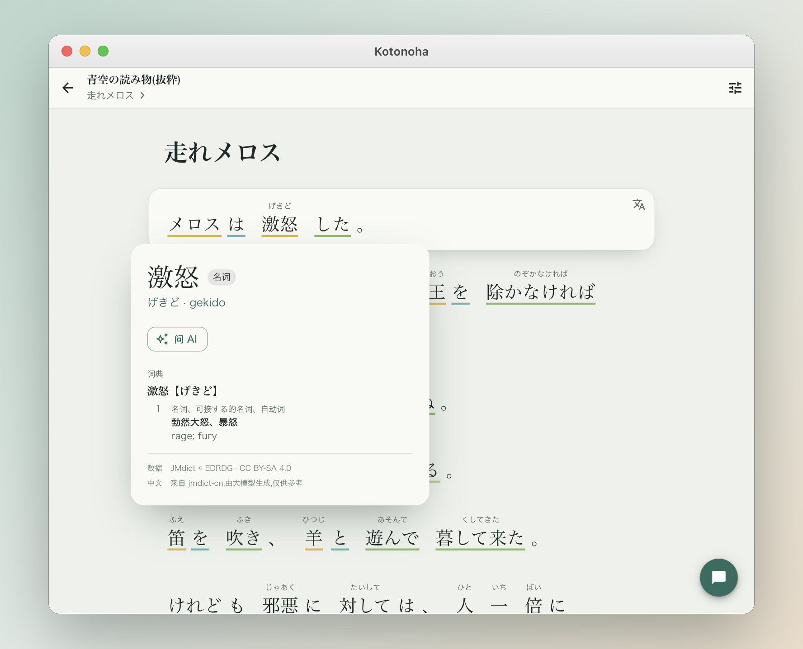
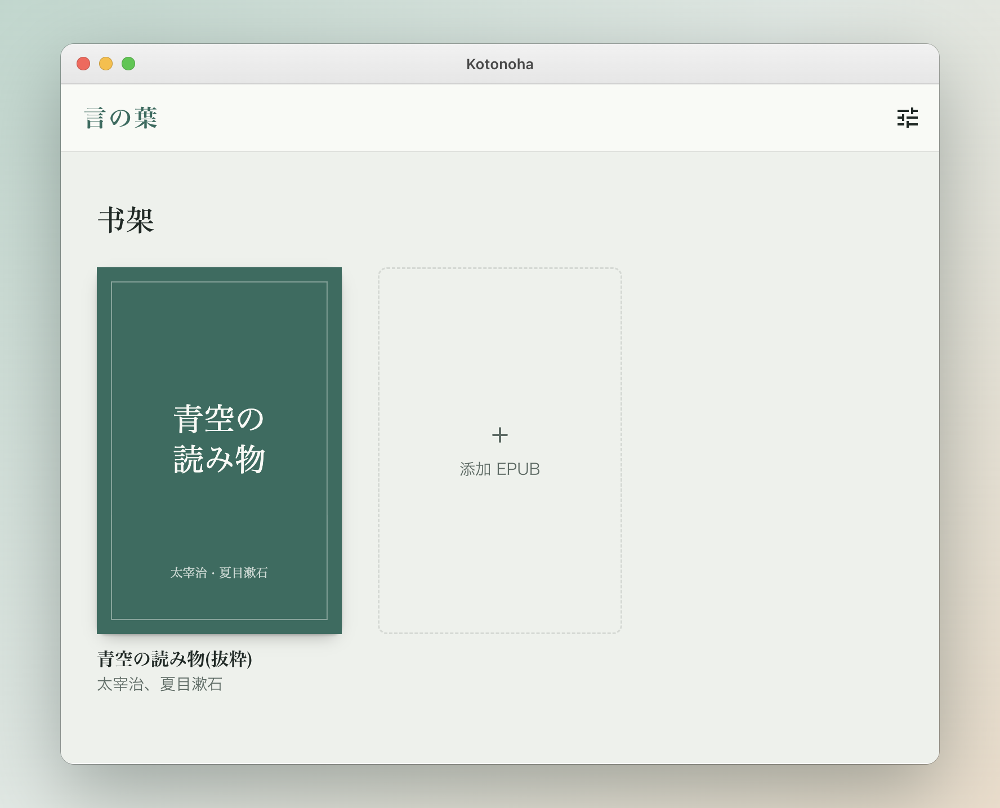
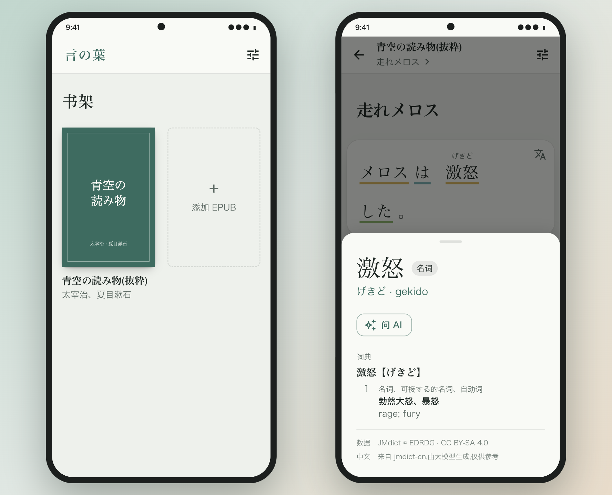

<div align="center">
  
  <h1>Kotonoha(言の葉)</h1>
  <p>给中文读者用的日文 EPUB 阅读器</p>
</div>

读小说时点一个词,可以看到它的原形、活用变化和词典义项,需要时再让 AI 结合上下文解释。桌面端和 Android 共用一套代码,基于 Tauri 2。

项目还在早期,没有发布过版本。



## 功能

- 书架:导入 EPUB,读出封面、作者和目录,记住读到哪一章。书存在本机,不上传。
- 阅读:按句排版,保留书里的振假名和插图。章末继续往下滑进入下一章,章首往上滑回上一章。
- 点词:显示原形、活用链(例如「湿っ + てる」各部分的作用)和 JMdict 义项,义项下方有中文释义。词类用下划线颜色区分。
- AI:点「问 AI」让模型结合当前句子解释这个词并选出贴切的义项。每句右上角有翻译按钮。右下角的悬浮窗可以围绕当前句和前后各两句提问,对话按书保存。
- 显示设置:振假名、罗马音、词性着色可以分别开关,也可以设成每句都显示译文。

AI 一律走云端,需要自己的 API Key,支持 Anthropic、OpenAI、Google 和 OpenAI 兼容接口。启用后,正在读的句子会发给你选的供应商,翻译和解说结果缓存在本地。不配置 AI 时,查词、原形、活用链和词典义项照常可用。

## 截图

macOS 书架:



Android 书架和点词弹窗:



示例书:太宰治《走れメロス》、夏目漱石《吾輩は猫である》。

## 安装

### macOS

从 [Releases](https://github.com/GuangChen2333/Kotonoha/releases) 下载 `Kotonoha-<版本>-macos-arm64.dmg`,只支持 Apple 芯片的 Mac。

1. 打开 dmg,把 Kotonoha 拖进「应用程序」。
2. 第一次打开时系统会提示无法验证开发者,点「完成」或「好」关掉。
3. 打开「系统设置」→「隐私与安全性」,滚动到「安全性」一栏,找到 Kotonoha 被阻止的提示,点「仍要打开」,再输入密码确认。之后就可以正常打开了。

macOS 15 以前也可以在「应用程序」里右键点 Kotonoha,选「打开」。如果设置里没有出现「仍要打开」,可以在终端里去掉隔离标记:

```sh
xattr -dr com.apple.quarantine /Applications/Kotonoha.app
```

## 运行

需要 Node.js、pnpm、Rust(edition 2024,最低 1.90)和 [Tauri 的系统依赖](https://tauri.app/start/prerequisites/)。

```sh
pnpm install
sh scripts/fetch-dict.sh      # 分词词典 UniDic
sh scripts/fetch-jmdict.sh    # JMdict 和中文释义,切成分片
pnpm tauri dev
```

词典文件放在 `public/dict/`,不进版本库,换机器后重新运行这两个脚本即可。

日常开发请用 `pnpm tauri dev`。也可以只运行 `pnpm dev` 在浏览器里看界面,但网页版把数据存在浏览器的存储里,和桌面应用不互通,也容易被清掉。桌面应用的数据在 Rust 端的 SQLite 里,macOS 上是 `~/Library/Application Support/moe.nyaneko.kotonoha/kotonoha.db`,API Key 单独放在系统钥匙串。

```sh
pnpm test                       # 前端测试
pnpm lint
pnpm build
(cd src-tauri && cargo test)    # Rust 测试
```

### Android

先设置 `ANDROID_HOME` 和 `NDK_HOME`,工程已经生成在 `src-tauri/gen/android`:

```sh
pnpm tauri android build --debug --apk --target aarch64
```

调试版的包名是 `moe.nyaneko.kotonoha.debug`,APK 约 200 MB,因为 Tauri 把整个前端(包括词典)嵌进了二进制。

## 技术栈

React 19、TypeScript、Vite。界面用 MUI,遵循 Material Design,主题色和圆角、弹层、底部抽屉等组件都来自 MUI。分词用 Lindera(WASM)加 UniDic。EPUB 解析用 foliate-js。AI 接入用 Vercel AI SDK。Rust 端用 SQLite(`rusqlite`)存数据,用 `keyring` 存密钥。

## 数据来源

- [JMdict](https://www.edrdg.org/wiki/index.php/JMdict-EDICT_Dictionary_Project) © EDRDG,CC BY-SA 4.0。EDRDG 的许可要求定期更新数据,由 `.github/workflows/dict-update.yml` 每两周检查新版本,更新 `dict-version.meta.json` 并发布新版。
- [jmdict-cn](https://github.com/zzhuxiaojun-glitch/jmdict-cn) 的中文释义,CC BY-SA 4.0。释义由大模型生成,没有人工校对。只覆盖约 2.3 万个常用词条;用一本测试小说量过,按词的种类约 72%、按出现次数约 90% 有中文释义。人名、复合动词和拟声词多数没有。

应用内的弹窗已经标出这两项来源。
